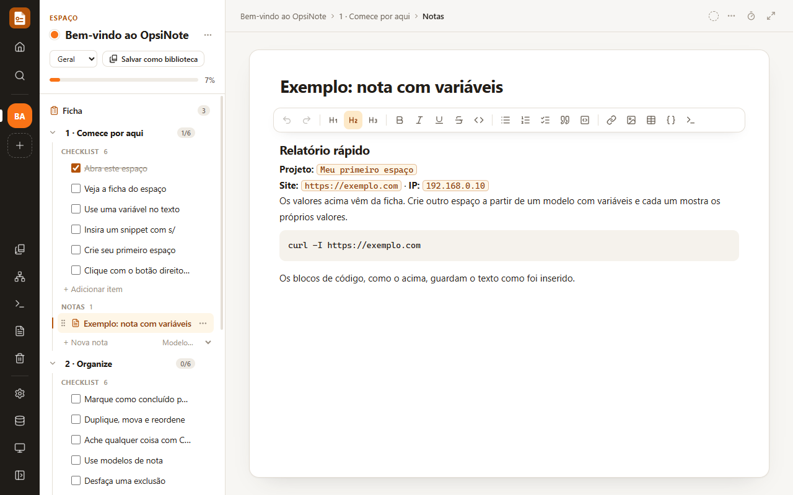

# OpsiNote

<p align="center">
  
</p>

<p align="center">
  Notas, checklists e acompanhamento de <b>alvos de pentest</b>, <b>estudos</b>, <b>projetos</b> e <b>tarefas</b>, num app desktop que guarda tudo no seu computador.
</p>

<p align="center">
  <a href="https://github.com/sacramentobernardes/OpsiNote/releases/latest/download/OpsiNote-Setup.exe"></a>
  &nbsp;
  <a href="docs/OpsiNote-Manual.pdf"></a>
</p>

<p align="center">
  <a href="https://github.com/sacramentobernardes/OpsiNote/releases/latest"></a>
</p>

## Destaques

- **Espaços com ficha**: cada alvo, matéria ou projeto tem seções com checklist, notas e uma ficha (IP, curso, repositório…).
- **Snippets com variáveis**: `nmap -sV {{ip}}` sai pronto, com o IP do espaço aberto.
- **Mapa mental** ligado ao espaço: o que muda num aparece no outro.
- **Bibliotecas e modelos** para reaproveitar roteiros e estruturas de nota.
- **Exporta e importa** JSON, HTML, Markdown, CSV e texto.
- **Offline e privado**: dados locais, sem buscar imagens na internet.

## Como usar

O instalador baixa a versão mais recente, e depois o app **se atualiza sozinho**. Na primeira abertura, o espaço **Bem-vindo ao OpsiNote** é um tour guiado dentro do próprio app.

> 📘 O passo a passo completo, com todos os recursos e exemplos, está no **[manual em PDF](docs/OpsiNote-Manual.pdf)**. Abaixo, um resumo. Clique para expandir.

<details>
<summary><b>Espaços, fichas e bibliotecas</b></summary>

<br>

- **Espaço**: o que você acompanha. Tem seções, e cada seção tem um checklist e notas.
- **Ficha**: primeira linha da árvore do espaço. Os campos mudam com a categoria (*Pentest*, *Estudo*, *Projeto*, *Tarefas*, *Geral*) e guardam as variáveis usadas nos snippets.
- **Bibliotecas**: checklists reutilizáveis. Crie um espaço a partir de uma, ou salve um espaço como biblioteca.
- **Modelos de nota**: estruturas prontas, como relatório de vulnerabilidade ou ata.
- **Fixados** e **Lixeira**: fixe o que mais usa no topo; o que é excluído pode ser restaurado por 30 dias.

Duplicar e mover ficam no menu **⋯** de cada linha; o botão direito num espaço abre as ações dele.

</details>

<details>
<summary><b>Snippets e variáveis</b></summary>

<br>

- Crie um snippet como `nmap -sV {{ip}}` e copie com um clique: `{{ip}}` vira o valor da ficha.
- Numa nota, digite `s/` para inserir um snippet já preenchido, ou `/` para inserir uma variável que acompanha a ficha.

</details>

<details>
<summary><b>Mapa mental</b></summary>

<br>

Cada espaço tem um mapa: seções nos ramos, tarefas e notas nos tópicos. Criar, renomear, marcar ou mover no mapa muda o espaço, e vice-versa. `Tab` cria um filho, `Enter` um irmão, e a barra tem arranjos, busca e **Salvar imagem** (PNG).

</details>

<details>
<summary><b>Foco e aparência</b></summary>

<br>

O botão de relógio no documento inicia sessões de foco de 15 a 90 minutos. Em **Configurações → Geral**, escolha tema, cor de destaque, densidade, estilo dos cartões e dos cantos.

</details>

<details>
<summary><b>Atalhos principais</b></summary>

<br>

| Atalho | O que faz |
| --- | --- |
| `Ctrl+K` | Busca em tudo e executa comandos |
| `Ctrl+/` | Lista todos os atalhos |
| `F1` | Ajuda |
| `Ctrl+Shift+N` | Novo espaço |
| `Ctrl+Enter` | Marca o item como concluído |
| `Ctrl+Shift+F` | Modo foco |

Todos podem ser trocados em **Configurações → Atalhos**.

</details>

<details>
<summary><b>Seus dados</b></summary>

<br>

Tudo é salvo sozinho em `%APPDATA%\OpsiNote\opsinote-data.json`, com uma cópia `.bak` a cada gravação. O menu **Dados** (no trilho) exporta e importa:

| Formato | Para quê |
| --- | --- |
| `.json` | Backup completo, sem perdas |
| `.html` | Ler no navegador ou imprimir |
| `.md` | Obsidian, Notion, GitHub |
| `.csv` | Excel ou Google Planilhas |
| `.txt` | Colar em qualquer lugar |

</details>

## Para desenvolvedores

<details>
<summary><b>Rodar, testar e lançar versões</b></summary>

<br>

Requer Node.js 20 ou mais recente.

```bash
npm install
npm run dev
```

| Comando | O que faz |
| --- | --- |
| `npm run build` | Versão de produção em `out/` |
| `npm run typecheck` | Verifica os tipos |
| `npm test` | Testes automatizados |
| `npm run package:win` | Instalador do Windows em `release/` |
| `npm run docs:pdf` | Gera o manual em PDF a partir de `docs/manual/manual.html` |

Para lançar: `npm version minor` (ou `patch`/`major`) e `git push --follow-tags`. O GitHub Actions testa, gera o instalador e publica a release.

Releases, ícone, assinatura do instalador e estrutura do código estão detalhados no capítulo 9 do [manual](docs/OpsiNote-Manual.pdf).

</details>

## Licença

GPL-3.0. Este projeto é derivado de um trabalho de código aberto distribuído sob a GNU General Public License v3.0.
